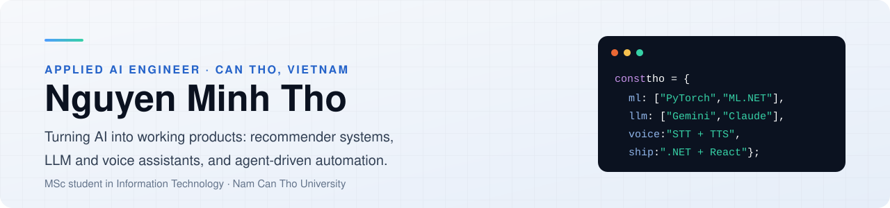

<picture>
  <source media="(prefers-color-scheme: dark)" srcset="https://raw.githubusercontent.com/ngminhthotech/ngminhthotech/main/assets/banner.svg">
  <source media="(prefers-color-scheme: light)" srcset="https://raw.githubusercontent.com/ngminhthotech/ngminhthotech/main/assets/banner-light.svg">
  
</picture>

### Hi, I'm Tho 👋

I build **AI into real products**. My work sits where models meet users: recommender systems trained on behaviour data, LLM assistants grounded in a business's own data, voice interfaces, and LLM agents that run content pipelines on their own every day. I ship these end to end, from the model to the API and the app around it.

I'm doing a Master's in Information Technology at Nam Can Tho University, where my research is on recommender systems for e-commerce.

- 🧠 **Machine learning:** recommender systems, matrix factorization, cold-start, rigorous evaluation
- 💬 **LLM applications:** grounded chatbots, prompt design, conversation memory, multi-key API handling
- 🎙️ **Voice AI:** speech-to-text → LLM → text-to-speech assistants
- 🤖 **AI agents and automation:** scheduled agent routines that collect data, write, voice, render and publish
- 📍 Can Tho, Vietnam

### Highlights

| 📈 **2×** | 🎙️ **Voice → answer → voice** | 🤖 **Daily, unattended** |
| :-- | :-- | :-- |
| Exact clothing-size accuracy, 25.5% → 51.0% on ModCloth, over 10 seeds with significance tests | One API call turns a citizen's spoken question into a spoken answer grounded in ward procedures | LLM agent routines publish a video bulletin every morning across three social channels |

### AI projects

| Project | What the AI does | Stack |
| --- | --- | --- |
| [**hybrid-size-recommender**](https://github.com/ngminhthotech/hybrid-size-recommender) | Research. A hybrid ordinal matrix-factorization model that recommends clothing sizes, even for brand-new shoppers. Doubles exact-size accuracy over the best-selling-size baseline (25.5% → 51.0% on ModCloth), evaluated over 10 seeds with significance tests. | Python · PyTorch · scikit-learn |
| [**DigiWard-Voice-API**](https://github.com/ngminhthotech/DigiWard-Voice-API) | Voice assistant for digital government. Citizens ask by voice; Gemini transcribes and answers from a knowledge base of administrative procedures, with conversation memory; ElevenLabs speaks the answer back. | ASP.NET Core · Gemini · ElevenLabs |
| [**AnFood-Fullstack**](https://github.com/ngminhthotech/AnFood-Fullstack) | Food ordering platform with two AI features: a Gemini chatbot that answers from the live menu, and personalised dish recommendations trained with ML.NET matrix factorization on user behaviour. | ASP.NET Core 8 · React 19 · Gemini · ML.NET |
| [**auto-post**](https://github.com/ngminhthotech/auto-post) | An LLM agent routine runs every morning: it collects and filters job listings, writes the script and captions, generates the voice-over, renders a video bulletin and schedules it to Facebook, TikTok and YouTube. | Python · LLM agents · TTS · Buffer API |
| [**Design24-newsletter**](https://github.com/ngminhthotech/Design24-newsletter) | Agent-driven channel for a design academy: two design-tutorial videos a day, scripted, voiced, rendered in rotating visual styles and scheduled automatically. | TypeScript · Remotion · Python · TTS |

<b>Software engineering projects</b>

| Project | What it is | Stack |
| --- | --- | --- |
| [**XuyenA-Agricommerce**](https://github.com/ngminhthotech/XuyenA-Agricommerce) | Agricultural e-commerce platform with a REST API, design diagrams and a Postman collection. | ASP.NET Core 8 · React · Vite |
| [**Clinic-Management-System**](https://github.com/ngminhthotech/Clinic-Management-System) | Desktop clinic management: patients, appointments, pharmacy stock, invoices and statistics, with role-based access. | C# · WPF · MVVM · EF Core |
| [**FastFood-Mobile**](https://github.com/ngminhthotech/FastFood-Mobile) | Android food ordering app with customer and admin roles, cart, order tracking and sales statistics. | Kotlin · Jetpack Compose · Room · Hilt |

### Toolkit

**🧠 AI and machine learning** 

**💬 LLMs, voice and AI assistants** 

**⚙️ Backend** 

**🎨 Frontend and video** 

**📱 Desktop and mobile** 

**🗄️ Databases** 

**🤖 Automation and integrations** 

**🛠️ Tools** 

### Research

**Overcoming Size Vanity in Online Retailing: An Intelligent Recommendation System for Apparel Fit** (2026) 
Nguyen Minh Duy, Tu The Hien, Nguyen Minh Tho, Tran Anh Tuan, Nguyen Thanh Toan · Nam Can Tho University 
[Paper](https://github.com/ngminhthotech/hybrid-size-recommender/blob/main/paper/sizerec-paper.pdf) · [Code](https://github.com/ngminhthotech/hybrid-size-recommender)

---

Xin chào! Mình là Thơ, làm ứng dụng AI ở Cần Thơ. Cứ thoải mái mở issue hoặc nhắn mình qua GitHub.
