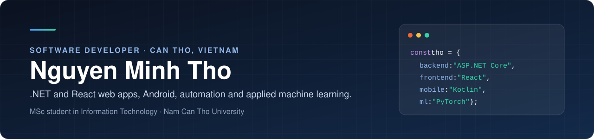

  

### Hi, I'm Tho 👋

I build web applications with **ASP.NET Core and React**, Android apps with **Kotlin and Jetpack Compose**, and small automation pipelines in **Python**. I'm currently doing a Master's in Information Technology at Nam Can Tho University, where my recent work is on recommender systems for e-commerce.

- 🔭 Working on: size recommendation for online fashion ([hybrid-size-recommender](https://github.com/ngminhthotech/hybrid-size-recommender))
- 🌱 Interested in: recommender systems, e-commerce platforms, AI-assisted public services
- 📍 Based in: Can Tho, Vietnam

### Featured projects

| Project | What it is | Stack |
| --- | --- | --- |
| [**hybrid-size-recommender**](https://github.com/ngminhthotech/hybrid-size-recommender) | Hybrid ordinal matrix-factorization model and CLI that recommends apparel sizes, including for brand-new shoppers. Evaluated on ModCloth and RentTheRunway over 10 seeds. | Python · PyTorch |
| [**AnFood-Fullstack**](https://github.com/ngminhthotech/AnFood-Fullstack) | Food ordering platform with customer, admin, payment and chatbot modules. | ASP.NET Core 8 · React 19 · MySQL |
| [**XuyenA-Agricommerce**](https://github.com/ngminhthotech/XuyenA-Agricommerce) | Agricultural e-commerce platform with a REST API, design diagrams and a Postman collection. | ASP.NET Core 8 · React · Vite |
| [**Clinic-Management-System**](https://github.com/ngminhthotech/Clinic-Management-System) | Desktop clinic management: patients, appointments, examinations, pharmacy stock, invoices and statistics, with role-based access. | C# · WPF · MVVM · EF Core |
| [**FastFood-Mobile**](https://github.com/ngminhthotech/FastFood-Mobile) | Android food ordering app with customer and admin roles, cart, order tracking and sales statistics. | Kotlin · Jetpack Compose · Room · Hilt |
| [**DigiWard-Voice-API**](https://github.com/ngminhthotech/DigiWard-Voice-API) | Voice assistant API that answers questions about administrative procedures for a digital-government platform. | C# · Gemini · ElevenLabs |

<b>Automation</b>

| Project | What it is | Stack |
| --- | --- | --- |
| [**auto-post**](https://github.com/ngminhthotech/auto-post) | Collects job listings and publishes branded image and video posts to Facebook, TikTok and YouTube Shorts on a schedule. | Python · Buffer API |
| [**Design24-newsletter**](https://github.com/ngminhthotech/Design24-newsletter) | Generates short design-tutorial videos with voice-over and schedules them across three social channels. | TypeScript · Remotion · Python |

### Tech stack

**Languages** 

**Frameworks** 

**Data and tools** 

### Research

**Overcoming Size Vanity in Online Retailing: An Intelligent Recommendation System for Apparel Fit** (2026) 
Nguyen Minh Duy, Tu The Hien, Nguyen Minh Tho, Tran Anh Tuan, Nguyen Thanh Toan · Nam Can Tho University 
[Paper](https://github.com/ngminhthotech/hybrid-size-recommender/blob/main/paper/sizerec-paper.pdf) · [Code](https://github.com/ngminhthotech/hybrid-size-recommender)

---

Xin chào! Mình là Thơ, lập trình viên ở Cần Thơ. Cứ thoải mái mở issue hoặc nhắn mình qua GitHub.
